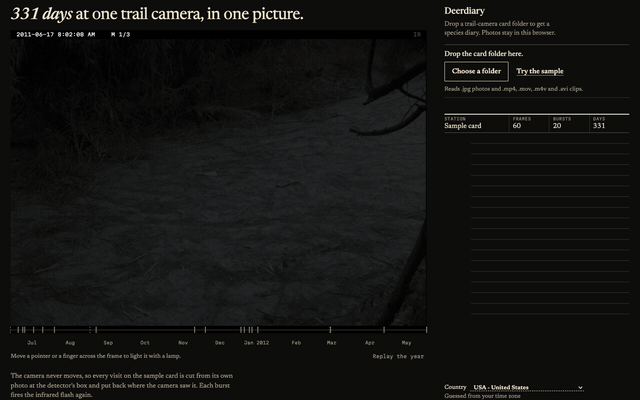

# Deerdiary

Read the visits on your trail camera.

Deerdiary groups animal sightings into a diary, so a burst of the same deer counts as a visit. See who appeared and when they came back.



**[Browse the sample diary](https://deerdiary.intesarjawad.com/)**. It opens without a model download.

The hosted page runs the sample only. It cannot read your own photos yet because the browser model files are unpublished; use the [local pipeline](docs/local-pipeline.md) for your card. Your photos stay on your computer.

Check the species labels: the sample contains mistakes and missed animals. Export a session you want to keep; clearing browser data deletes its diary.

## Run it locally

With Node 22 or newer:

```sh
npx https://github.com/intesarjawad/deerdiary/releases/download/v0.1.0/deerdiary-0.1.0.tgz
```

For development (Node 26, plus Python 3.12 and uv for the model tools):

```sh
npm ci && cd tools && uv sync --locked --group onnx && cd ..
npm run dev
npm run check
```

More in [docs/development.md](docs/development.md) and [docs/architecture.md](docs/architecture.md). To contribute, see [CONTRIBUTING.md](CONTRIBUTING.md) and [SECURITY.md](SECURITY.md).

## What you get

- **A diary.** One card per species, counted per visit, so forty frames of the same deer count as one visit.
- **An activity clock.** When each species shows up, by hour.
- **A highlight reel** you can export as video.
- **Your data out.** CSV, SpeciesNet JSON, MegaDetector JSON and [Camtrap DP](docs/camtrap-dp-export.md).
- **Corrections.** When a card is wrong, search the species list and pick the right one. The fix carries into the exports.

## Your photos stay on your computer

Photos are decoded, detected and classified in a browser worker. Results live in your browser's IndexedDB. The only network requests are the model files from Hugging Face, each checked against a SHA-256 before use.

You can verify this yourself. A footer meter lists every request by host, or open DevTools, watch the Network tab and drop a card. After the first load it also works offline. Details: [docs/privacy.md](docs/privacy.md).

Clearing site data deletes your diaries, and Safari can clear it after a period without a visit. Use "Export this session" to keep one.

## How it works

1. A detector (MegaDetector v6) boxes animals, people and vehicles in each photo.
2. Up to five animal boxes per photo are cropped and named by SpeciesNet's classifier.
3. SpeciesNet's own ensemble rules, ported to TypeScript, combine the two scores and apply the geographic filter for your country. The thresholds are upstream's, unchanged ([ADR 0004](docs/adr/0004-ensemble.md)).
4. Photos group into bursts and visits, and the diary counts species per visit.

A burst splits at a 60 second gap. A species counts as a new visit more than 30 minutes after its last one. Detections below 0.2 confidence are ignored. Videos are sampled at one frame per second, up to 10 frames. The reasoning is in [ADR 0005](docs/adr/0005-bursts-events-independence.md).
<!-- number: 60 s burst gap, src/core/events.ts BURST_GAP_MS -->
<!-- number: 30 min independence interval, src/core/independence.ts DEFAULT_INDEPENDENCE_INTERVAL_MIN -->
<!-- number: 0.2 minimum confidence, src/core/events.ts MAXN_MIN_CONF -->
<!-- number: 10 video frames, src/files/video.ts VIDEO_MAX_FRAMES -->

The app runs ONNX Runtime Web on WASM, because [WebGPU gave different labels on the sample](tests/fixtures/sample-backend-parity.json). The 2,000-photo evaluation below ran on WebGPU, so its numbers belong to that experiment. You can also run the reference SpeciesNet pipeline yourself and import its JSON ([docs/local-pipeline.md](docs/local-pipeline.md)).

## What it gets wrong

Check species labels before you rely on them. The hosted sample is a finished diary from 60 Caltech Camera Traps photos. `npm run sample:score` compares it with the dataset's own annotations. On 60 photos:

- 3 of the 12 empty photos still add a card, as "Unidentified animal".
- 1 raccoon lands on the coyote card.
- All 3 rodents and 1 of 3 squirrels land on "mammal", because the classifier names no narrower group.
- 2 squirrels, 1 bird and 1 coyote reach no card.
<!-- number: 60 photos, 12 empty, 3 of 12 empty frames add to a card, npm run sample:score -->
<!-- number: raccoon -> coyote 1, rodent -> mammal 3, squirrel -> mammal 1, squirrel -> (no card) 2, bird -> (no card) 1, coyote -> (no card) 1, npm run sample:score -->

<!-- evaluation:results -->
On 2,000 ENA24 photos (USA), the WebGPU experiment using the default pipeline (fp32 detector, fp16 classifier) names the right species in **86.27%** of single-species photos (95% CI 84.57% to 87.72%); official SpeciesNet scores **86.72%** on the same photos. It agrees with the official empty-or-not call on **99.75%**. Exact label lists, one entry per detection, match on **40.20%**. ENA24 may overlap SpeciesNet training data, so this is not an independent benchmark. The WASM app build is not separately measured. [Definitions and limits](docs/evaluation.md).
<!-- /evaluation:results -->

## Where it fits

Deerdiary reads a card with no install, no account and no upload. It is not an analysis package, and it does not replace a team platform. Wildlife Insights, AddaxAI, Timelapse, TRAPPER, camtrapR and Zamba Cloud each do something it does not: [how they compare](docs/comparison.md).

## Models, licences and credits

Code is MIT ([LICENSE](LICENSE)). Models are downloaded on first use, never bundled: MegaDetector v6 and the SpeciesNet v4.0.3a classifier, both recorded as Apache-2.0. One licence question on the detector is still open, so read [docs/models.md](docs/models.md) before redistributing it.

Thanks to the Google SpeciesNet team for the classifier, taxonomy, geofence and reference ensemble; to Dan Morris, the MegaDetector contributors and the Microsoft AI for Good Lab; and to the Caltech Camera Traps authors and LILA BC for the sample photos ([provenance](public/sample/PROVENANCE.txt)).

Type is Newsreader by Production Type and Martian Mono by Evil Martians (SIL OFL 1.1). The opening picture borrows its form from David Hockney's photographic joiners, and its relighting follows Dominik Fojcik's "light that reveals" technique on Codrops. The sample frame's depth map was computed once with Depth Anything V2 Small (Apache-2.0).
