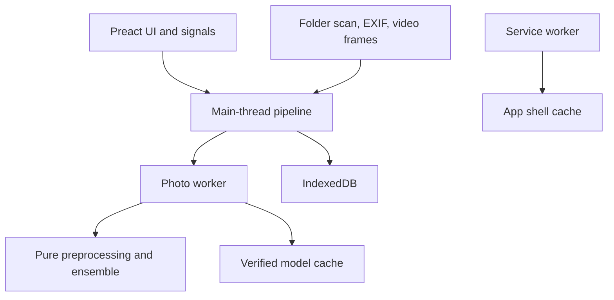

# Architecture

A pure TypeScript core sits under a thin browser shell. `src/files/` scans a dropped folder, reads EXIF capture times and samples video frames. `src/app/` runs the pipeline, loads and verifies the models, imports and exports predictions, and serves the precomputed sample. `src/workers/` holds the photo worker, which runs the detector and classifier with ONNX Runtime Web. `src/storage/` keeps results, sessions and corrections in IndexedDB, and `src/ui/` renders the diary from signals.

Photos go to the photo worker one at a time. A video is sampled on the main thread at one frame per second, up to ten frames; each frame goes through the photo worker and the clip is stored as one result whose boxes give its MaxN. Audio files are counted and listed but not processed: the audio worker exists and is not started by the app.

`src/core/` must not import the browser shell or ORT. Workers use the core and ORT. UI reads application signals and never touches IndexedDB. Models are fetched at runtime after hash verification.

Python export, parity, golden and evaluation tools live under `tools/` and use Python 3.12. See [ADR 0008](adr/0008-web-stack.md) and [development notes](development.md).
